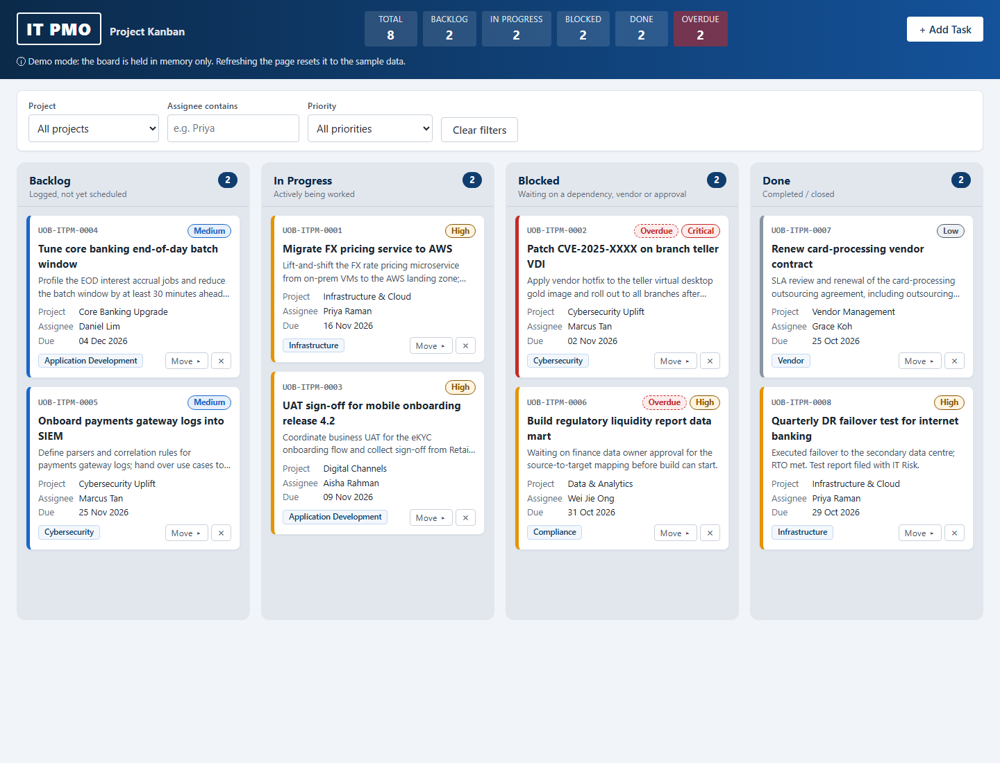

# pmo3: IT PMO Project Kanban (Demo)

**Live demo:** https://alfredang.github.io/pmo3/



A single-file Kanban board for an IT Project Management Office at a fictitious bank. It is built as an internal demo and training tool with vanilla HTML, CSS and JavaScript, and has no dependencies.

> **Demo data only.** The bank, people, projects and tasks are all fictitious sample data. The `UOB-ITPM-####` task IDs and the `[UOB IT PMO]` email subject are text-only config values; this project does not use or imitate any real bank's logo or systems.

## Features

- Four columns: Backlog, In Progress, Blocked and Done. Move cards by drag and drop, or with the keyboard-accessible "Move ▸" menu.
- Add Task form with inline validation, plus inline "Delete? Yes / No" confirmation.
- Filters by project, assignee and priority. Column counts follow the filters; the header summary always counts every task.
- Overdue highlighting: a task is overdue when its due date has passed and it is not Done.
- An optional email notification for each new task, sent via [FormSubmit](https://formsubmit.co).
- **No persistence.** The board lives in memory, and refreshing the page resets it to the seed data. This is intentional.

## Running locally

There is nothing to build or install. Open `index.html` in a browser:

```powershell
Start-Process index.html
```

To make the email notifications work, serve the page from an origin instead. FormSubmit may reject requests from `file://` pages:

```powershell
python -m http.server 8000   # then open http://localhost:8000/
```

## Configuration

At the top of the `<script>` block in `index.html`:

| Constant | Purpose |
|---|---|
| `FORMSUBMIT_ENDPOINT` | `https://formsubmit.co/ajax/YOUR_EMAIL@example.com`. **Placeholder:** replace the address with the inbox that should receive new-task emails. This is the only place it appears. |
| `ID_PREFIX` | Prefix for generated task IDs (zero-padded to 4 digits). |
| `SUBJECT_PREFIX` | Subject prefix for notification emails. |
| `NOTIFY_TIMEOUT_MS` | Timeout for the FormSubmit request. |

FormSubmit needs a **one-time activation**. The first submission to a new address sends that address a confirmation email, and nothing is delivered until someone clicks the link in it. Until then FormSubmit replies `success: "false"` and the board shows a warning toast. The task is still added either way: a notification failure never breaks the board.

## Deployment

On every push to `main`, [.github/workflows/pages.yml](.github/workflows/pages.yml) publishes the repository root to GitHub Pages. There is no build step.

## Contributor conventions

- **Keep everything in `index.html`.** Use vanilla HTML, CSS and JS only: no frameworks, CDNs, web fonts or image assets. Use a system font stack, and Unicode or inline SVG for icons.
- **No storage APIs** (localStorage, sessionStorage, IndexedDB, cookies). The only network call is `notifyNewTask()`.
- **No `alert()` or `confirm()`.** Use inline errors, the inline delete row and toasts.
- **CSS:** no `!important`. Take colours and spacing from the custom properties in `:root`.
- **State is the single source of truth.** Mutations change `state`, then call `renderBoard()`; never patch card DOM directly. Pass every user-supplied string through `escapeHtml()`.
- **Column `data-status` values** in the markup must match the `STATUSES` array.
- **Dates** are local ISO `YYYY-MM-DD` strings. Seed data uses `daysFromToday(n)`, so the demo always has overdue cards.

See [CLAUDE.md](CLAUDE.md) for the full architecture notes.

## Testing

There is no automated test suite. Test manually in a browser: add, move, filter and delete tasks, check the keyboard flows, and check the notification toast.
